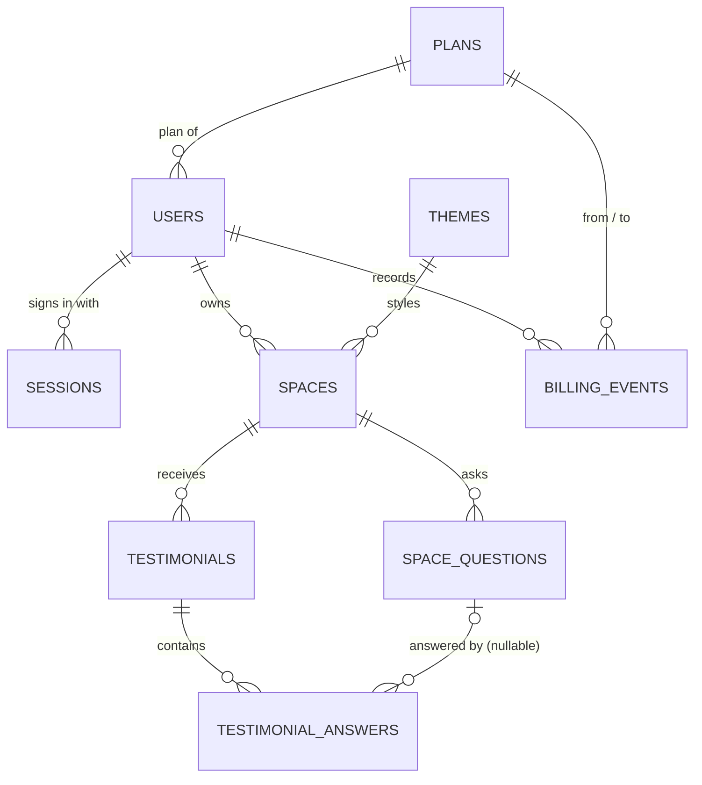

# Data model

**Status: Final** (11 November 2026). Derived from [PRD §10–§11](PRD.md#11-final-feature-scope-11-november-2026), reviewed with the `mysql` and `review-mysql-model` skills, and checked on a disposable copy of the schema (22/22 behaviour checks on MySQL 8.0.46; see [verification.md → Skill usage log](verification.md#skill-usage-log) #2–#3). Migrations are written from this file; any later change is made here first, then as a new migration.

Question numbers (Q…) refer to the grill-me session; D… and R… are the defaults and review changes approved on 11 November 2026.



`schema_migrations` (migration runner bookkeeping) has no relationships.

## Conventions

| Topic | Rule | Ref |
| --- | --- | --- |
| Data table keys | `id BIGINT UNSIGNED AUTO_INCREMENT PRIMARY KEY`; never in public URLs (public pages use the slug). | Q2 |
| Lookup table keys | Short text `code VARCHAR(20) PRIMARY KEY`, referenced by `<name>_code` columns. | Q4a |
| Lookup table vs `CHECK` | Lookup table when values carry their own data (`plans`, `themes`); `VARCHAR` + `CHECK` for plain states (field modes, billing event type, billing interval), with matching constants in server code. | Q4, Q4c |
| Time | `DATETIME` in UTC (pool `timezone: 'Z'`). `created_at DATETIME NOT NULL DEFAULT CURRENT_TIMESTAMP` everywhere; `updated_at … ON UPDATE CURRENT_TIMESTAMP` on tables whose rows change. | Q3 |
| Character sets | Tables `utf8mb4` / `utf8mb4_0900_ai_ci`. **Exceptions:** `users.email` uses `utf8mb4_bin` (stored lowercased; the default accent-insensitive collation would treat `jose@` and `josé@` as the same address); hashes, slugs, colours, currency codes, and checksums use `ascii` (`ascii_bin` where compared). | R1, R2 |
| Optional text | `NOT NULL DEFAULT ''`. `NULL` only where it carries meaning: file paths, `rating`, `original_body`, `edited_at`, `testimonial_answers.question_id`, `plans.billing_interval`. | R3 |
| Booleans | `TINYINT(1) NOT NULL DEFAULT 0` (or `1` where stated). | — |
| Money | Whole numbers in the smallest unit (`*_minor`, poisha for BDT) plus ISO 4217 `currency`. | Q4b |
| Foreign keys | Every relationship is a real FK. Owned data uses `ON DELETE CASCADE`; lookup references use the default `RESTRICT`. | D11 |

**Deviations from the `mysql` skill (kept on purpose):** money as integer minor units instead of `DECIMAL(19,4)` (exact, and the format payment APIs use); `VARCHAR` + `CHECK` (enforced since MySQL 8.0.16) instead of lookup tables for plain states; inbox search with `LIKE '%…%'` instead of `FULLTEXT` (at most 1,000 rows per space).

## Tables

Migration order follows dependencies: `schema_migrations` (created by the runner) → `plans` → `themes` → `users` → `sessions` → `spaces` → `space_questions` → `testimonials` → `testimonial_answers` → `billing_events`.

### `plans` — lookup, seeded (Q4b)

| Column | Type | Notes |
| --- | --- | --- |
| `code` | `VARCHAR(20)` PK | `free`, `paid` |
| `name` | `VARCHAR(50) NOT NULL` | |
| `price_minor` | `INT UNSIGNED NOT NULL` | `0`, `99900` (৳999.00) |
| `currency` | `CHAR(3) CHARACTER SET ascii NOT NULL` | `BDT` |
| `billing_interval` | `VARCHAR(10) NULL` | `NULL` (free) or `month`; `CHECK (billing_interval IS NULL OR billing_interval IN ('month'))` |
| `max_spaces` | `INT UNSIGNED NOT NULL` | `3`, `25` |
| `max_testimonials_per_space` | `INT UNSIGNED NOT NULL` | `100`, `1000` |
| `sort_order` | `TINYINT UNSIGNED NOT NULL` | `1`, `2` |
| `created_at`, `updated_at` | `DATETIME` | |

| code | name | price_minor | currency | billing_interval | max_spaces | max_testimonials_per_space | sort_order |
| --- | --- | ---: | --- | --- | ---: | ---: | ---: |
| `free` | Free | 0 | BDT | NULL | 3 | 100 | 1 |
| `paid` | Paid | 99900 | BDT | month | 25 | 1000 | 2 |

### `themes` — lookup, seeded (D1)

| Column | Type | Notes |
| --- | --- | --- |
| `code` | `VARCHAR(20)` PK | `light`, `dark`, `warm` |
| `name` | `VARCHAR(50) NOT NULL` | Light, Dark, Warm |
| `sort_order` | `TINYINT UNSIGNED NOT NULL` | 1, 2, 3 |

Theme colours live in client CSS keyed by `code`; the owner's `brand_color` is the accent on top.

### `users` (Q5, Q6)

| Column | Type | Notes |
| --- | --- | --- |
| `id` | `BIGINT UNSIGNED` PK | |
| `name` | `VARCHAR(100) NOT NULL` | Trimmed, 1–100 |
| `email` | `VARCHAR(254) COLLATE utf8mb4_bin NOT NULL` | Trimmed + lowercased before saving; `UNIQUE` |
| `password_hash` | `VARCHAR(255) NOT NULL` | `scrypt$<params>$<salt>$<hash>`; never returned |
| `plan_code` | `VARCHAR(20) NOT NULL DEFAULT 'free'` | FK → `plans.code`; never set by the client |
| `created_at`, `updated_at` | `DATETIME` | |

### `sessions` — append-only (Q7, Q7a)

| Column | Type | Notes |
| --- | --- | --- |
| `id` | `BIGINT UNSIGNED` PK | |
| `token_hash` | `CHAR(64) CHARACTER SET ascii COLLATE ascii_bin NOT NULL` | SHA-256 hex of the cookie token; `UNIQUE` |
| `user_id` | `BIGINT UNSIGNED NOT NULL` | FK → `users.id` `ON DELETE CASCADE` |
| `expires_at` | `DATETIME NOT NULL` | `created_at` + 7 days |
| `created_at` | `DATETIME` | |

Indexes: `UNIQUE (token_hash)`, `INDEX (expires_at)` (cleanup), FK index on `user_id`.

### `spaces` (FR-02 – FR-04; D2, D3)

| Column | Type | Notes |
| --- | --- | --- |
| `id` | `BIGINT UNSIGNED` PK | |
| `owner_id` | `BIGINT UNSIGNED NOT NULL` | FK → `users.id` `ON DELETE CASCADE` |
| `slug` | `VARCHAR(60) CHARACTER SET ascii COLLATE ascii_bin NOT NULL` | `UNIQUE`; `CHECK`: 3–60 chars, `^[a-z0-9]+(-[a-z0-9]+)*$` |
| `title` | `VARCHAR(100) NOT NULL` | |
| `subtitle` | `VARCHAR(200) NOT NULL DEFAULT ''` | |
| `prompt` | `VARCHAR(500) NOT NULL` | Collection prompt |
| `thank_you_message` | `VARCHAR(500) NOT NULL DEFAULT ''` | Empty = default text |
| `theme_code` | `VARCHAR(20) NOT NULL DEFAULT 'light'` | FK → `themes.code` |
| `brand_color` | `CHAR(7) CHARACTER SET ascii NOT NULL DEFAULT '#4F46E5'` | `CHECK`: `^#[0-9A-Fa-f]{6}$` |
| `logo_path` | `VARCHAR(255) NULL` | Relative path under `server/uploads/logos/` |
| `job_title_mode`, `company_mode`, `social_link_mode`, `photo_mode`, `rating_mode` | `VARCHAR(10) NOT NULL DEFAULT 'off'` | `CHECK` each `IN ('off','optional','required')` |
| `created_at`, `updated_at` | `DATETIME` | |

Indexes: `UNIQUE (slug)`, `INDEX (owner_id, created_at)`.
Slug (D2): suggested from the title; the owner may change it later (the old link stops working; the UI warns; no redirect history).

### `space_questions` (D4)

| Column | Type | Notes |
| --- | --- | --- |
| `id` | `BIGINT UNSIGNED` PK | |
| `space_id` | `BIGINT UNSIGNED NOT NULL` | FK → `spaces.id` `ON DELETE CASCADE` |
| `question_text` | `VARCHAR(200) NOT NULL` | |
| `position` | `TINYINT UNSIGNED NOT NULL` | Display order |
| `is_active` | `TINYINT(1) NOT NULL DEFAULT 1` | |
| `created_at`, `updated_at` | `DATETIME` | |

Index: `(space_id, position)`.
Rules (server): at most **5 active** questions per space. Removing a question with **no answers** deletes it; one **with answers** is deactivated (`is_active = 0`).

### `testimonials` (FR-05 – FR-09, FR-12; D5, R4, R5)

| Column | Type | Notes |
| --- | --- | --- |
| `id` | `BIGINT UNSIGNED` PK | |
| `space_id` | `BIGINT UNSIGNED NOT NULL` | FK → `spaces.id` `ON DELETE CASCADE` |
| `name` | `VARCHAR(100) NOT NULL` | Always required |
| `email` | `VARCHAR(254) NOT NULL` | Always required; **never in public queries** |
| `job_title` | `VARCHAR(100) NOT NULL DEFAULT ''` | |
| `company` | `VARCHAR(100) NOT NULL DEFAULT ''` | |
| `social_link` | `VARCHAR(300) NOT NULL DEFAULT ''` | `http`/`https` only (server) |
| `photo_path` | `VARCHAR(255) NULL` | Relative path under `server/uploads/photos/` |
| `rating` | `TINYINT UNSIGNED NULL` | `CHECK (rating IS NULL OR rating BETWEEN 1 AND 5)` |
| `body` | `VARCHAR(2000) NOT NULL` | Testimonial text (current) |
| `original_body` | `VARCHAR(2000) NULL` | Customer's text, saved on the owner's **first** edit (D5) |
| `edited_at` | `DATETIME NULL` | Set on every owner edit; public wall shows a small "edited" note |
| `consent_public` | `TINYINT(1) NOT NULL DEFAULT 0` | Public-display consent |
| `consent_social` | `TINYINT(1) NOT NULL DEFAULT 0` | Social-sharing consent (separate) |
| `is_hidden`, `is_favorite`, `on_wall` | `TINYINT(1) NOT NULL DEFAULT 0` | |
| `created_at`, `updated_at` | `DATETIME` | |

Constraint (R4): `CHECK (on_wall = 0 OR (consent_public = 1 AND is_hidden = 0))` — the database itself guarantees the wall rule. Consequence: **hiding a testimonial also removes it from the wall**; unhiding does not put it back automatically.
Index (R5): `(space_id, created_at)` only (InnoDB appends `id`). It serves the locked/visible ranking, the inbox, and the graph; add more indexes only if `EXPLAIN` shows a need. Inbox search: `LIKE '%term%'` over `name`, `company`, `body` within one space.

### `testimonial_answers` — append-only

| Column | Type | Notes |
| --- | --- | --- |
| `id` | `BIGINT UNSIGNED` PK | |
| `testimonial_id` | `BIGINT UNSIGNED NOT NULL` | FK → `testimonials.id` `ON DELETE CASCADE` |
| `question_id` | `BIGINT UNSIGNED NULL` | FK → `space_questions.id` `ON DELETE SET NULL` |
| `question_snapshot` | `VARCHAR(200) NOT NULL` | Question text at submission time |
| `answer_text` | `VARCHAR(1000) NOT NULL` | |
| `position` | `TINYINT UNSIGNED NOT NULL` | |
| `created_at` | `DATETIME` | |

### `billing_events` — append-only (FR-13; D6)

| Column | Type | Notes |
| --- | --- | --- |
| `id` | `BIGINT UNSIGNED` PK | |
| `user_id` | `BIGINT UNSIGNED NOT NULL` | FK → `users.id` `ON DELETE CASCADE` |
| `event_type` | `VARCHAR(30) NOT NULL` | `CHECK (event_type IN ('upgrade_simulated'))` |
| `from_plan_code`, `to_plan_code` | `VARCHAR(20) NOT NULL` | FK → `plans.code` |
| `amount_minor` | `INT UNSIGNED NOT NULL` | What would have been charged (99900) |
| `currency` | `CHAR(3) CHARACTER SET ascii NOT NULL` | `BDT` |
| `is_simulated` | `TINYINT(1) NOT NULL DEFAULT 1` | `CHECK (is_simulated = 1)` — a real payment can never be recorded |
| `created_at` | `DATETIME` | |

Index: `(user_id, created_at)`. No card or payment data is ever stored.
D6: no downgrade action and no expiry; Paid stays Paid. `npm run db:reset` returns to Free for testing. "Per month" is shown as the price only.

### `schema_migrations` — runner bookkeeping

| Column | Type | Notes |
| --- | --- | --- |
| `filename` | `VARCHAR(255)` PK | e.g. `001_create_plans.sql` |
| `checksum` | `CHAR(64) CHARACTER SET ascii NOT NULL` | SHA-256 of the file; an edited, already-applied migration is an error |
| `applied_at` | `DATETIME NOT NULL DEFAULT CURRENT_TIMESTAMP` | |

## Rules implemented in queries (not stored)

### Accept but lock (FR-12)

In each space, testimonials are ranked by `(created_at, id)`; rank ≤ *N* (the owner's `plans.max_testimonials_per_space`) is **visible**, the rest **locked**:

```sql
SELECT t.*, ROW_NUMBER() OVER (ORDER BY t.created_at, t.id) AS rn
FROM testimonials t
WHERE t.space_id = ?
-- visible: rn <= N ; locked: rn > N
```

Locked rows are never returned by inbox detail, edit, wall, or embed queries; only their count is shown. Hidden rows count toward *N*; deleting frees capacity; upgrading raises *N*. Verified: 105 rows → 100 visible / 5 locked on Free, all visible after upgrade; the base table is read by a covering index lookup on `(space_id, created_at)`.

### Locking and limits (D10, R6)

- **Create space:** in one transaction — `SELECT … FROM users WHERE id = ? FOR UPDATE` (with the plan's `max_spaces`), then `COUNT(*)` of the owner's spaces, then insert or reject. The count must come **after** the locking read in the same REPEATABLE READ transaction. Verified: 4 concurrent requests at the Free limit → exactly 3 spaces; without the lock → 5.
- **Submit testimonial:** `SELECT … FROM spaces WHERE id = ? FOR UPDATE`, count, reject at the **1,000 hard cap**, insert testimonial and answers, commit.
- Lock order is always **user → space**; no transaction locks a space and then a user. On deadlock (error 1213) retry once.
- **File I/O stays outside transactions:** save the uploaded file first; if the transaction fails, delete the file.
- **Moderation (M4, E40–E46):** in one transaction, lock only the testimonial row, scoped to the owner (`SELECT … FROM testimonials t JOIN spaces s … WHERE t.id = ? AND t.space_id = ? AND s.owner_id = ? FOR UPDATE OF t`). Then work out its rank with a plain (snapshot) `ROW_NUMBER()` read, and update or delete it by primary key. Checked with two connections: the lock does not block the submit path (space row), the create-space path (user row), or new inserts, and it does block a second moderation of the same row. Photo files are deleted only after commit. *Mixing a locking read with a snapshot read (mysql skill, isolation-levels) was reviewed and kept:* a testimonial's rank can only go down (deletes), and its limit can only go up (upgrade; there is no downgrade in the MVP). So a stale snapshot can only call a row locked a moment after it became visible, which is the safe direction. Reading the rank `FOR SHARE` would lock up to 1,000 index records and block submissions. EXPLAIN ANALYZE at 1,000 rows: rank about 0.8 ms through `(space_id, created_at)`.
- **Public wall (E48):** first rank only the ids of the space (narrow temp table), then join the visible ones (rank ≤ N) back to `testimonials` by primary key, and filter `on_wall = 1 AND is_hidden = 0 AND consent_public = 1`. No extra index is needed (at most 1,000 rows per space).

### Access (PRD §5, R7)

- Every private read/write is scoped through `spaces.owner_id = <authenticated user id>`, including updates, deletes, statistics, and testimonial actions (join through `spaces`). Owner IDs, plans, and counts from the browser are never trusted.
- Public collection page reads only the space's display fields and active questions.
- Public wall and embed queries **list columns explicitly** (never `SELECT *`): `name`, `job_title`, `company`, `photo_path`, `rating`, `body`, `edited_at`, `created_at`, filtered by `on_wall = 1 AND is_hidden = 0 AND consent_public = 1` and not locked. Never `email`, consent flags, `original_body`, or answers.
- All SQL is parameterized.

### Uploads (D9)

- Logos and profile photos: JPEG, PNG, or WebP, at most **2 MB**; type checked from the file's content (magic bytes), not its name or the browser's MIME type.
- Saved with random file names under `server/uploads/logos/` and `server/uploads/photos/` (gitignored); only the relative path is stored.
- Files are deleted when their testimonial or space is deleted, or when a logo is replaced or removed.

### Deleting (D11)

Deleting a space cascades to its questions, testimonials, and answers (FKs), then the app deletes its logo and photos. Deleting a testimonial cascades to its answers and deletes its photo.

## Not stored in the database

| Data | Where instead | Ref |
| --- | --- | --- |
| Embed settings (layout, mode, background, animation) | iframe URL, e.g. `/embed/:slug?layout=grid&mode=dark&bg=ffffff&animate=1`; each value whitelisted | D7 |
| Recent activity | Derived: latest 10 of new testimonials, created spaces, billing events (`UNION ALL`) | D8 |
| Locked status | Calculated (above) | FR-12 |
| Rate-limit counters | Server memory | Q9 |

## Limits (D12)

| Field | Max |
| --- | --- |
| User name / email / password | 100 / 254 / 8–128 |
| Space title / subtitle / prompt / thank-you message | 100 / 200 / 500 / 500 |
| Slug | 3–60 |
| Questions per space / question text | 5 active / 200 |
| Testimonial name / email / job title / company / social link | 100 / 254 / 100 / 100 / 300 |
| Testimonial text / each answer | 2,000 / 1,000 |
| Logo or photo | 2 MB, JPEG/PNG/WebP |
| Saved testimonials per space (hard cap) | 1,000 |

## Plan limits

| Plan | Price | Spaces per owner | Visible testimonials per space |
| --- | --- | ---: | ---: |
| Free | ৳0 | 3 | 100 |
| Paid (demo) | ৳999 / month | 25 | 1,000 |

Space creation past the limit is rejected; testimonials past the limit are accepted but locked; hard cap 1,000 saved per space.
