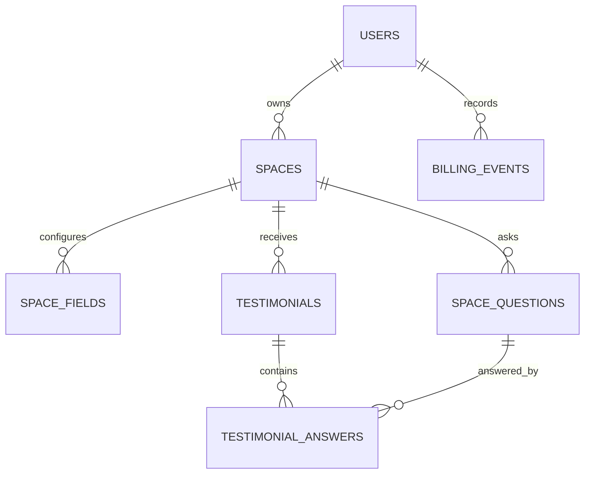

# Proposed data model

**Status:** Design proposal, not a migration. Review against the final PRD and refine through OpenSpec before writing SQL.

## Tables

| Table | Suggested columns | Important constraints |
| --- | --- | --- |
| `users` | `id`, `name`, `email`, `password_hash`, `plan` (`free`/`paid`), timestamps | Unique email; default plan `free`; hash passwords. |
| `spaces` | `id`, `owner_id`, `slug`, `title`, `subtitle`, `prompt`, `theme`, timestamps | FK owner; unique slug; index owner_id. |
| `space_fields` | `id`, `space_id`, `field_key`, `enabled`, `required` | Unique (`space_id`, `field_key`); allowed keys `name`, `email`, `company`, `social_link`, `profile_photo`; name/email enabled+required by server rule. |
| `space_questions` | `id`, `space_id`, `question_text`, `position`, `active` | FK space; stable ID; ordered positions. |
| `testimonials` | `id`, `space_id`, `name`, `email`, `company`, `social_link`, `photo_path`, `body`, `consent_public`, `consent_social`, `hidden`, `favorite`, `on_wall`, `edited_at`, `created_at` | FK space; indexes (`space_id`, `created_at`), (`space_id`, `favorite`, `created_at`), (`space_id`, `on_wall`, `hidden`); default all consent and publication flags false. |
| `testimonial_answers` | `id`, `testimonial_id`, `question_id`, `question_snapshot`, `answer_text` | FK testimonial and question; store question snapshot for historical readability. |
| `billing_events` | `id`, `user_id`, `event_type`, `from_plan`, `to_plan`, `is_simulated`, `created_at` | FK user; mark simulated events clearly; never store payment/card details. |

## Access and integrity

- Every private space/testimonial query must scope through `spaces.owner_id = authenticated_user_id` on the server, including update actions and statistics. Do not accept owner IDs from request bodies as authority.
- Public collection reads only published space configuration; public wall reads only `on_wall = true AND hidden = false AND consent_public = true`. Never return email, consent flags, or private answer fields from public wall queries.
- Create space inside an owner-scoped, concurrency-safe quota operation. Create testimonial inside a space-scoped, concurrency-safe quota operation. Use a transaction and row lock or equivalent; verify the chosen MySQL isolation/locking approach under concurrent requests.
- Keep server-side validation as the source of truth. Photo upload should restrict MIME type, size, and storage path; do not store binary photos in this table.
- Apply migrations to a disposable local database first, then document the exact commands in README.

## Plan limits

| Plan | Maximum spaces per owner | Maximum saved testimonials per space |
| --- | ---: | ---: |
| Free | 3 | 100 |
| Paid (demo state) | 25 | 1,000 |

These limits count saved rows even when hidden. Upgrading changes future limits; no existing data is deleted.
