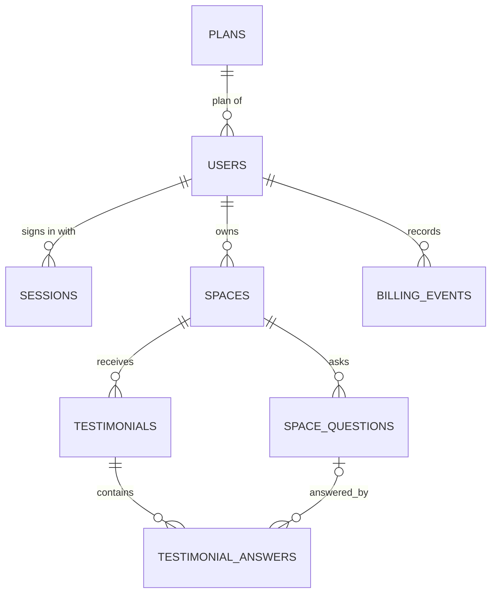

# Data model

**Status:** Being finalised feature by feature in a `grill-me` session (started 11 November 2026). **Decided:** conventions, `plans`, `users`, `sessions` (FR-01 Login). **Still proposed:** everything under "Proposed — not yet decided". Becomes **Final** when every feature has been decided; migrations are written only from decided sections.

`PLANS`, `USERS`, and `SESSIONS` are decided; the other entities are still proposed and may change.

## Conventions (decided)

Apply to every table. Question numbers refer to the grill-me session (see [PRD §10](PRD.md#10-decisions-from-the-grill-me-session)).

| Topic | Rule | Q |
| --- | --- | --- |
| Data table keys | `id BIGINT UNSIGNED AUTO_INCREMENT PRIMARY KEY`. Never exposed in public URLs; public pages use the space slug. | Q2 |
| Lookup table keys | A short text `code VARCHAR(20) PRIMARY KEY` (for example `'free'`), referenced by `<name>_code` columns. | Q4a |
| Lookup table vs `CHECK` | Use a **lookup table** when the values carry their own data (plans; themes if they hold names/colours). Use **`VARCHAR` + `CHECK`** for plain states (field mode, billing event type, billing interval), with matching constants in server code. | Q4, Q4c |
| Time | `DATETIME` in **UTC** (pool uses `timezone: 'Z'`); not `TIMESTAMP`. Every table has `created_at DATETIME NOT NULL DEFAULT CURRENT_TIMESTAMP`; tables whose rows change also have `updated_at DATETIME NOT NULL DEFAULT CURRENT_TIMESTAMP ON UPDATE CURRENT_TIMESTAMP`. Append-only tables have only `created_at`. | Q3 |
| Text | Database and tables use `utf8mb4` / `utf8mb4_0900_ai_ci`. | M0 |
| Money | Whole numbers in the smallest unit (`price_minor`, poisha for BDT) plus an ISO 4217 `currency`; never decimals or floats. | Q4b |

**Deviation from the `mysql` skill, recorded:** the skill prefers lookup tables over `ENUM`; we follow it for sets with their own data, and use `VARCHAR` + `CHECK` (enforced since MySQL 8.0.16) for plain states, because a lookup table for values like `off/optional/required` adds joins and seed rows with no benefit.

## Decided tables

### `plans` (lookup, seeded by migration) — Q4, Q4a, Q4b

| Column | Type | Notes |
| --- | --- | --- |
| `code` | `VARCHAR(20)` PK | `'free'`, `'paid'` |
| `name` | `VARCHAR(50) NOT NULL` | `'Free'`, `'Paid'` |
| `price_minor` | `INT UNSIGNED NOT NULL` | `0`, `99900` (৳999.00) |
| `currency` | `CHAR(3) NOT NULL` | `'BDT'` |
| `billing_interval` | `VARCHAR(10) NULL` | `NULL` (free), `'month'` (paid); `CHECK (billing_interval IN ('month'))` |
| `max_spaces` | `INT UNSIGNED NOT NULL` | `3`, `25` |
| `max_testimonials_per_space` | `INT UNSIGNED NOT NULL` | `100`, `1000` |
| `sort_order` | `TINYINT UNSIGNED NOT NULL` | `1`, `2` |
| `created_at`, `updated_at` | `DATETIME` | |

Seed rows:

| code | name | price_minor | currency | billing_interval | max_spaces | max_testimonials_per_space | sort_order |
| --- | --- | ---: | --- | --- | ---: | ---: | ---: |
| `free` | Free | 0 | BDT | NULL | 3 | 100 | 1 |
| `paid` | Paid | 99900 | BDT | month | 25 | 1000 | 2 |

Quota checks and the billing page both read limits and price from this table (single source of truth). No admin UI edits it; changes go through a migration. The Paid plan is a **simulation**: no money is charged.

### `users` — Q5, Q6

| Column | Type | Notes |
| --- | --- | --- |
| `id` | `BIGINT UNSIGNED` PK AUTO_INCREMENT | |
| `name` | `VARCHAR(100) NOT NULL` | Trimmed, 1–100 characters |
| `email` | `VARCHAR(254) NOT NULL` | Trimmed and lowercased before saving; `UNIQUE` |
| `password_hash` | `VARCHAR(255) NOT NULL` | `scrypt$<params>$<salt>$<hash>`; never returned by the API |
| `plan_code` | `VARCHAR(20) NOT NULL DEFAULT 'free'` | FK → `plans.code`; never set by the client |
| `created_at`, `updated_at` | `DATETIME` | |

Indexes: `UNIQUE (email)`; FK index on `plan_code`.

### `sessions` (append-only) — Q7, Q7a

| Column | Type | Notes |
| --- | --- | --- |
| `id` | `BIGINT UNSIGNED` PK AUTO_INCREMENT | |
| `token_hash` | `CHAR(64) NOT NULL` | SHA-256 (hex) of the random 32-byte cookie token; `UNIQUE` |
| `user_id` | `BIGINT UNSIGNED NOT NULL` | FK → `users.id` `ON DELETE CASCADE` |
| `expires_at` | `DATETIME NOT NULL` | `created_at` + 7 days (fixed) |
| `created_at` | `DATETIME` | |

Indexes: `UNIQUE (token_hash)`, `INDEX (user_id)`, `INDEX (expires_at)`.
Rules: a session is valid only while `expires_at > UTC_TIMESTAMP()`; logout deletes its row; expired rows are deleted on each login; many sessions per user are allowed.

Not stored in the database (decided): login/registration rate-limit counters (in memory, Q9).

## Proposed — not yet decided

These come from the original draft and will be revisited feature by feature. Known pending decisions are noted.

| Table | Suggested columns | Important constraints | Pending |
| --- | --- | --- | --- |
| `spaces` | `id`, `owner_id`, `slug`, `title`, `subtitle`, `prompt`, `theme`, timestamps | FK owner; unique slug; index owner_id. | Spaces feature: slug rules, themes as lookup table, field settings (draft `space_fields` table vs mode columns) |
| `space_questions` | `id`, `space_id`, `question_text`, `position`, `active` | FK space; stable ID; ordered positions. | Question count/length limits, delete vs deactivate |
| `testimonials` | `id`, `space_id`, `name`, `email`, `company`, `social_link`, `photo_path`, `body`, `consent_public`, `consent_social`, `hidden`, `favorite`, `on_wall`, `edited_at`, `created_at` | FK space; indexes (`space_id`, `created_at`), (`space_id`, `favorite`, `created_at`), (`space_id`, `on_wall`, `hidden`); default all consent and publication flags false. | Length limits, photo storage, keeping original text after owner edits, `updated_at` |
| `testimonial_answers` | `id`, `testimonial_id`, `question_id`, `question_snapshot`, `answer_text` | FK testimonial and question; store question snapshot for historical readability. | `question_id` nullable / `ON DELETE` behaviour |
| `billing_events` | `id`, `user_id`, `event_type`, `from_plan`, `to_plan`, `is_simulated`, `created_at` | FK user; mark simulated events clearly; never store payment/card details. | Event types, plan code references, how "per month" behaves in the demo |

Also pending: embed settings storage (FR-10), recent-activity source (FR-11), quota locking strategy (FR-12), migration runner and seed data.

## Access and integrity

- Every private space/testimonial query must scope through `spaces.owner_id = authenticated_user_id` on the server, including update actions and statistics. Do not accept owner IDs from request bodies as authority.
- Public collection reads only published space configuration; public wall reads only `on_wall = true AND hidden = false AND consent_public = true`. Never return email, consent flags, or private answer fields from public wall queries.
- Create space inside an owner-scoped, concurrency-safe quota operation. Create testimonial inside a space-scoped, concurrency-safe quota operation. Use a transaction and row lock or equivalent; verify the chosen MySQL isolation/locking approach under concurrent requests.
- Keep server-side validation as the source of truth. Photo upload should restrict MIME type, size, and storage path; do not store binary photos in this table.
- Apply migrations to a disposable local database first, then document the exact commands in README. Automated tests use a separate `testimonial_mvp_test` database (Q14).

## Plan limits

Stored in the `plans` table (decided above):

| Plan | Price | Maximum spaces per owner | Maximum saved testimonials per space |
| --- | --- | ---: | ---: |
| Free | ৳0 | 3 | 100 |
| Paid (demo) | ৳999 / month | 25 | 1,000 |

These limits count saved rows even when hidden. Upgrading changes future limits; no existing data is deleted.
